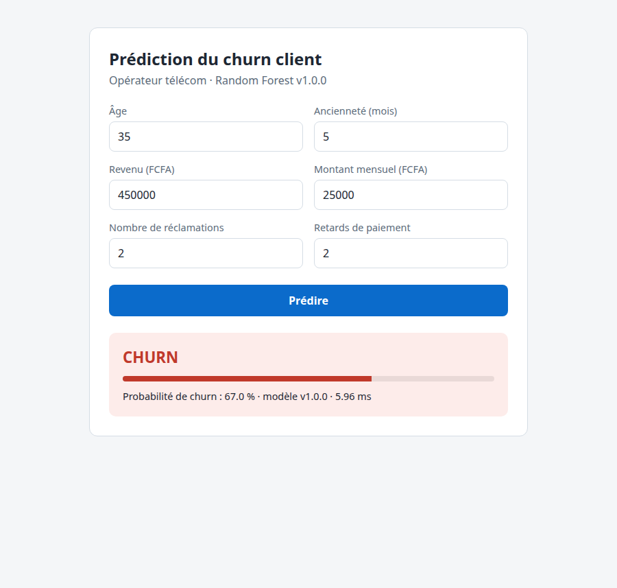
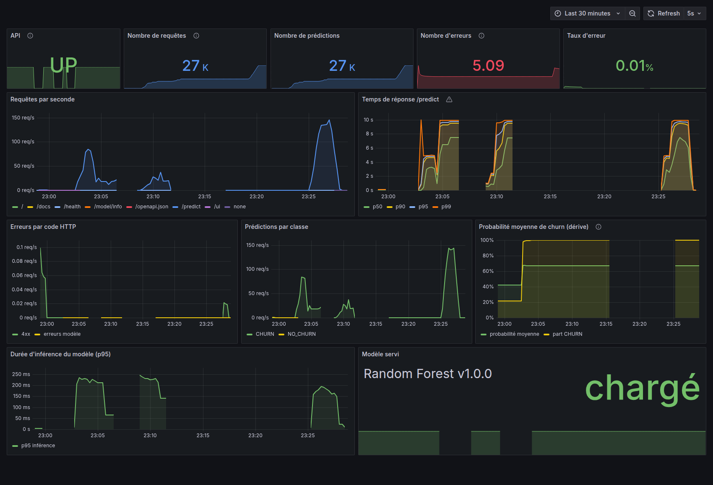
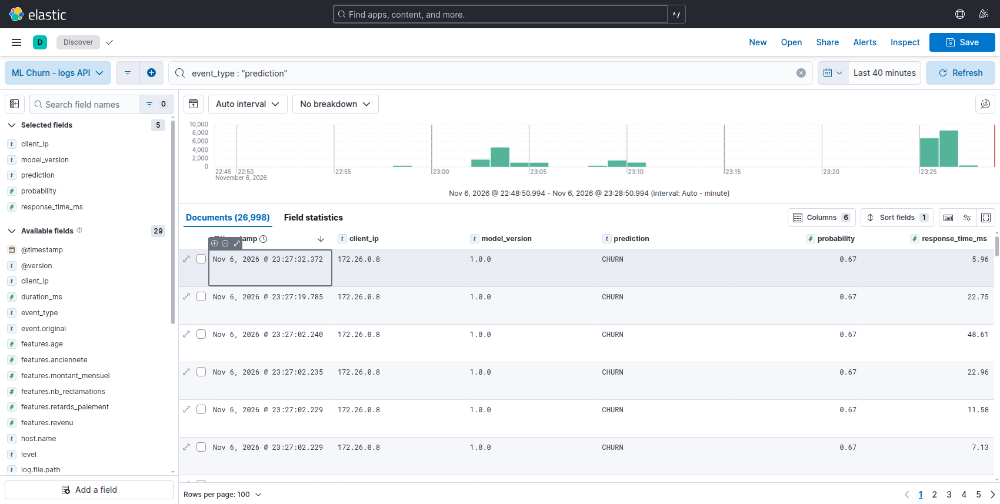

# ML Churn Project — Industrialisation d'un modèle de prédiction du churn

[](https://github.com/ibrahima-2/ml-churn/actions/workflows/ci.yml)

Ce projet prédit le **churn** (résiliation) des clients d'un opérateur télécom. Il transforme
un modèle de Machine Learning en application **déployable, testable, monitorée et maintenable**.

```
Data (CSV) → Entraînement (scikit-learn) → model.pkl → API FastAPI → Docker
                                                          │
                                  logs JSON ──► Logstash ──► Elasticsearch ──► Kibana
                                  /metrics  ──► Prometheus ──► Grafana
```

| Composant | Technologie | URL locale |
|---|---|---|
| API de prédiction + Swagger | FastAPI / Uvicorn | http://localhost:8000/docs |
| Interface web | HTML/JS servi par l'API | http://localhost:8000/ui/ |
| Métriques | Prometheus | http://localhost:9090 |
| Dashboards | Grafana (admin / admin) | http://localhost:3000 |
| Recherche de logs | Kibana | http://localhost:5601 |
| Stockage des logs | Elasticsearch | http://localhost:9200 |

---

## 1. Arborescence

```
ml-churn-project/
├── api/                      # API FastAPI (main.py) + configuration du logging JSON
├── frontend/                 # Interface web (formulaire « Prédire »)
├── src/                      # generate_data.py, train.py
├── notebooks/                # exploration.ipynb (notebook Data Science) + exploration.py
├── data/raw/churn.csv        # Dataset (2000 clients, généré avec seed=42)
├── models/                   # model.pkl + metadata.json (version, métriques) + metrics.json
├── tests/
│   ├── test_api.py           # Tests API (pytest + TestClient)
│   ├── test_model.py         # Tests unitaires données / modèle
│   ├── test_selenium.py      # Tests E2E Selenium
│   └── performance/          # Plan JMeter + script 100/500/1000 utilisateurs
├── monitoring/
│   ├── prometheus/           # prometheus.yml + alerts.yml
│   └── grafana/              # datasource + dashboard provisionnés automatiquement
├── docker/
│   ├── logstash/             # pipeline logstash.conf
│   └── kibana/               # création automatique de la data view
├── docs/                     # Documentation technique, rapport, soutenance
├── reports/figures/          # Graphiques d'exploration
├── .github/workflows/ci.yml  # CI GitHub Actions
├── Dockerfile
├── docker-compose.yml
├── requirements.txt          # Dépendances d'exécution (image Docker)
└── requirements-dev.txt      # + Data Science, pytest, selenium
```

---

## 2. Guide d'installation

### 2.1 Pré-requis

| Outil | Version testée | Vérification |
|---|---|---|
| Python | 3.11 (Docker/CI), 3.13 (local) | `python3 --version` |
| Git | 2.x | `git --version` |
| Docker + Compose v2 | 29.x / v5 | `docker --version` · `docker compose version` |
| Mémoire Docker | **≥ 4 Go** pour la stack ELK | Docker Desktop → Settings → Resources |
| JMeter (optionnel) | 5.6 | sinon le script utilise l'image Docker `alpine/jmeter:5.6.3` |
| Chrome (tests E2E) | récent | ou Selenium en conteneur (voir §5.3) |

Sous Ubuntu, si Docker n'est pas installé :

```bash
sudo apt update && sudo apt install docker.io docker-compose-v2 -y
sudo systemctl enable --now docker
sudo usermod -aG docker $USER      # puis se déconnecter / reconnecter
docker run hello-world
```

### 2.2 Environnement Python

```bash
git clone https://github.com/ibrahima-2/ml-churn.git
cd ml-churn

python3 -m venv .venv
source .venv/bin/activate          # Windows : .venv\Scripts\activate
pip install --upgrade pip
pip install -r requirements-dev.txt
```

> **Pourquoi deux fichiers ?** `requirements.txt` contient uniquement ce dont l'API a besoin
> (image Docker plus légère). `requirements-dev.txt` ajoute les outils de Data Science et de test.
> Les versions sont figées : un `model.pkl` doit être rechargé avec **la même version de scikit-learn**.

---

## 3. Data Science

```bash
python src/generate_data.py        # -> data/raw/churn.csv
python notebooks/exploration.py    # -> reports/figures/*.png
python src/train.py                # -> models/model.pkl, metadata.json, metrics.json
```

Résultats sur le jeu de test (400 clients, split stratifié 80/20) :

| Modèle | Accuracy | Precision | Recall | F1 | ROC-AUC |
|---|---|---|---|---|---|
| Logistic Regression | 0.625 | 0.582 | 0.454 | 0.510 | **0.636** |
| Decision Tree | **0.633** | **0.583** | **0.512** | **0.545** | 0.623 |
| Random Forest *(déployé)* | 0.600 | 0.544 | 0.436 | 0.484 | 0.625 |

Déployer un autre modèle ou une nouvelle version :

```bash
python src/train.py --model logistic_regression --version 1.1.0
```

Le notebook complet (exploration, comparaison et importance des variables) est dans
[notebooks/exploration.ipynb](notebooks/exploration.ipynb).

---

## 4. API

```bash
uvicorn api.main:app --reload
```

| Méthode | Route | Rôle |
|---|---|---|
| GET | `/` | Informations sur l'application |
| GET | `/health` | Santé : `200 UP` si le modèle est chargé, sinon `503` |
| GET | `/model/info` | Nom, version, date d'entraînement, features, métriques du modèle |
| POST | `/predict` | Prédiction du churn pour un client |
| GET | `/metrics` | Métriques Prometheus |
| GET | `/docs` | Swagger UI |
| GET | `/ui/` | Interface web |

```bash
curl -X POST http://127.0.0.1:8000/predict \
  -H "Content-Type: application/json" \
  -d '{"age":35,"anciennete":5,"revenu":450000,"nb_reclamations":2,"montant_mensuel":25000,"retards_paiement":2}'
```

```json
{"prediction": "CHURN", "probability": 0.67, "model_version": "1.0.0", "duration_ms": 12.4}
```

Les entrées sont validées : un champ manquant, mal typé ou hors bornes (par exemple `age < 18`)
renvoie une erreur `422`.

---

## 5. Tests

### 5.1 Tests unitaires et API

```bash
pytest -m "not e2e" -v       # 20 tests unitaires et API (aucun serveur nécessaire)
pytest                       # + les 3 tests Selenium (ignorés si l'API est arrêtée)
```

### 5.2 Tests E2E Selenium (Chrome local)

```bash
uvicorn api.main:app &        # ou : docker compose up -d api
pytest tests/test_selenium.py -v
```

Scénario testé : ouverture de `/ui/` → saisie des données client → clic sur « Prédire » →
appel à l'API → affichage du résultat → vérification. Le cas d'erreur de validation est aussi testé.

> Si Chrome n'est pas installé, Selenium Manager tente de le télécharger automatiquement, ce qui
> peut être très long sur une connexion lente. Dans ce cas, utiliser la variante en conteneur
> ci-dessous, ou exclure ces tests avec `pytest -m "not e2e"`.



### 5.3 Tests E2E sans Chrome installé (Selenium en conteneur)

```bash
docker compose up -d api
docker run -d --name selenium --network ml-churn_default -p 4444:4444 --shm-size=2g selenium/standalone-chromium
SELENIUM_REMOTE_URL=http://localhost:4444 E2E_BASE_URL=http://api:8000 \
  E2E_HEALTH_URL=http://localhost:8000 pytest tests/test_selenium.py -v
docker rm -f selenium
```

### 5.4 Tests de charge JMeter

```bash
docker compose up -d api
tests/performance/run_load_tests.sh            # 100, 500 puis 1000 utilisateurs
# ou en GUI : jmeter -t tests/performance/churn_load_test.jmx
```

Les rapports HTML sont générés dans `tests/performance/results/<N>_users/report/index.html`
et le tableau de synthèse dans `tests/performance/results/summary.md`.

Résultats mesurés (1 worker Uvicorn, Apple Silicon, stack complète démarrée) :

| Utilisateurs | Moyenne | p95 | Débit | Erreurs |
|---|---|---|---|---|
| 100 | 6 ms | 11 ms | 101 req/s | 0 % |
| 500 | 2,5 s | 3,5 s | 143 req/s | 0 % |
| 1000 | 5,9 s | 7,1 s | 145 req/s | 0 % |

Le service sature à environ 145 req/s par worker. L'analyse complète est dans
[docs/rapport_industrialisation.md](docs/rapport_industrialisation.md).

---

## 6. Docker

```bash
docker build -t ml-churn-api:1.0 .
docker run -d --name ml-churn-api -p 8000:8000 ml-churn-api:1.0
curl http://localhost:8000/health
docker stop ml-churn-api && docker rm ml-churn-api
```

### Stack complète avec Docker Compose

```bash
docker compose up -d --build          # API + Prometheus + Grafana + Elasticsearch + Logstash + Kibana
docker compose ps
docker compose logs -f api
docker compose down                   # arrêt (ajouter -v pour supprimer aussi les volumes)
```

API seule (version initiale du sujet) : `docker compose up -d --build api`.

---

## 7. Observabilité

### Logs → ELK

L'API écrit **une ligne JSON par événement** dans `/app/logs/api.log`. Ce fichier est dans un
volume partagé avec Logstash, qui l'envoie dans l'index Elasticsearch `ml-churn-logs-YYYY.MM.dd`.
La data view Kibana `ml-churn-logs-*` est créée automatiquement.

Chaque log répond aux questions du sujet :

| Question | Champ |
|---|---|
| Quand ? | `@timestamp` |
| Qui ? | `client_ip`, `user_agent`, `request_id` |
| Quelle opération ? | `event_type` (`prediction`, `http_request`, `prediction_error`…), `method`, `path` |
| Quel modèle ? | `model_name`, `model_version` |
| Quel résultat ? | `prediction`, `probability`, `status_code` |
| Combien de temps ? | `response_time_ms` (inférence), `duration_ms` (requête complète) |
| Quelle erreur ? | `level: ERROR`, `error`, `exception` |

Exemples de recherches dans Kibana (Discover, langage KQL) :

```
event_type : "prediction"
level : "ERROR"
model_version : "1.0.0" and prediction : "CHURN"
event_type : "http_request" and duration_ms > 100
```

### Métriques → Prometheus → Grafana

Le dashboard **ML Churn API** est provisionné automatiquement (Grafana → Dashboards → ML Churn).
Il affiche :

- l'état de l'API ;
- le nombre de requêtes et les requêtes par seconde ;
- le temps de réponse (p50, p90, p95, p99) ;
- le nombre et le taux d'erreurs ;
- le nombre de prédictions et leur répartition par classe ;
- la probabilité moyenne, qui sert d'indicateur de dérive ;
- la durée d'inférence et la version du modèle servi.

Des règles d'alerte sont définies dans `monitoring/prometheus/alerts.yml` : API down,
plus de 5 % d'erreurs 5xx, p95 au-dessus de 500 ms et dérive des prédictions.





---

## 8. Git et CI/CD

Branches : `main` (production) ← `develop` (intégration) ← `feature/*` (développement).

Le pipeline [.github/workflows/ci.yml](.github/workflows/ci.yml) se lance à chaque push ou pull
request sur `main` et `develop` :

1. **test** : installation, génération des données, entraînement, `pytest` (rapport JUnit et modèle archivés) ;
2. **docker** : build de l'image et smoke test du conteneur (`/health` et `/predict`) ;
3. **e2e** : démarrage de l'API avec `docker compose`, puis tests Selenium dans Chrome headless.

---

## 9. Déploiement sur une VM Linux

```bash
sudo apt update && sudo apt install git docker.io docker-compose-v2 -y
git clone https://github.com/ibrahima-2/ml-churn.git
cd ml-churn
docker compose build
docker compose up -d
docker compose ps
curl http://SERVER_IP:8000/health
```

Penser à ouvrir les ports 8000, 3000 et 5601 dans le pare-feu et le groupe de sécurité de la VM.
**Ne pas exposer 9200 (Elasticsearch) sur Internet.** Changer le mot de passe Grafana avec la
variable `GRAFANA_ADMIN_PASSWORD`.

---

## 10. Documentation

- [docs/documentation_technique.md](docs/documentation_technique.md) : architecture, choix techniques, API, configuration
- [docs/rapport_industrialisation.md](docs/rapport_industrialisation.md) : démarche, résultats, tests de charge, corrections apportées au sujet
- [docs/soutenance.md](docs/soutenance.md) : réponses aux 28 questions de soutenance
